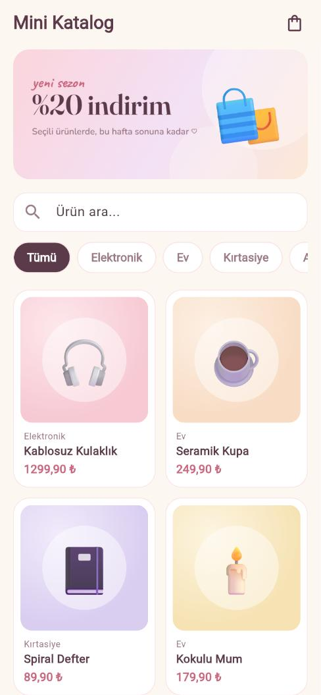
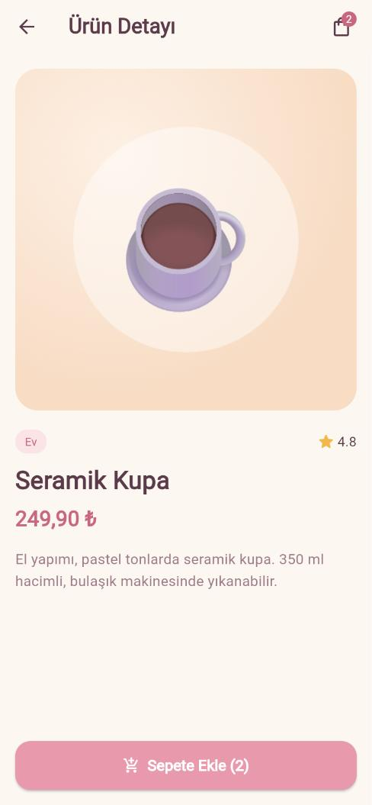
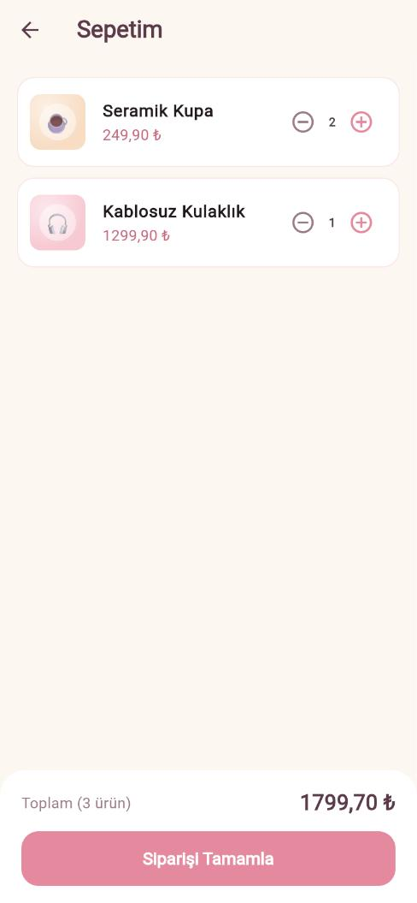
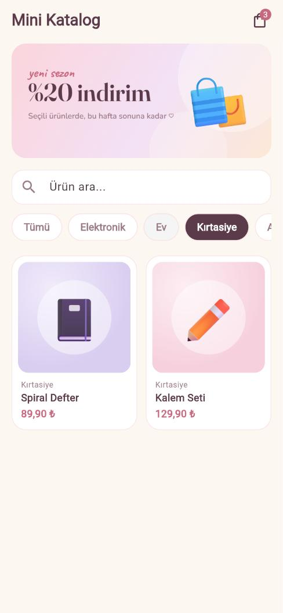

# Mini Katalog

Flutter eğitimi sonunda hazırladığım basit bir ürün katalog uygulaması. Ürünler ana sayfada kartlar halinde listeleniyor, ürüne tıklayınca detay sayfası açılıyor ve ürünler sepete eklenebiliyor (sepet simülasyon, gerçek ödeme yok).

## Ekran Görüntüleri

| Ana Sayfa | Ürün Detayı | Sepet |
|---|---|---|
|  |  |  |

| Arama / Filtre |
|---|
|  |

## Kullanılan Sürümler

- Flutter 3.50.0 (stable)
- Dart 3.14.0
- Sadece `material.dart` kullanıldı, ekstra paket yok

## Özellikler

- Banner görseli, ürün arama ve kategoriye göre filtreleme
- `GridView` ile ürün kartları
- `Navigator.pushNamed` ve named routes ile sayfa geçişleri
- Ürün bilgisinin detay sayfasına **route arguments** ile taşınması
- `assets/data/products.json` dosyasından veri okuma (JSON simülasyonu)
- `Product` model sınıfı (`fromJson` / `toJson`)
- `Image.asset` ile görseller
- Sepete ekleme, adet artırma/azaltma ve toplam tutar (ChangeNotifier ile basit state güncelleme)

## Proje Yapısı

```
lib/
  main.dart                  -> MaterialApp, tema ve route tanımları
  theme.dart                 -> renkler ve tema
  models/product.dart        -> ürün model sınıfı
  data/product_service.dart  -> JSON'dan ürünleri okuma
  data/cart.dart             -> sepet (state)
  pages/home_page.dart       -> ana sayfa (banner, arama, grid)
  pages/product_detail_page.dart
  pages/cart_page.dart
  widgets/product_card.dart
  widgets/cart_button.dart
assets/
  images/                    -> banner ve ürün görselleri
  data/products.json         -> ürün verileri
```

## Çalıştırma

1. Flutter SDK kurulu olmalı (`flutter --version` ile kontrol edilebilir).
2. Projeyi indir:

```bash
git clone https://github.com/serra0781/MiniKatalog.git
cd MiniKatalog
```

3. Paketleri yükle:

```bash
flutter pub get
```

4. Emülatörü aç ya da telefonu bağla, sonra çalıştır:

```bash
flutter run
```

Emülatör yoksa tarayıcıda da çalıştırılabilir:

```bash
flutter run -d chrome
```
